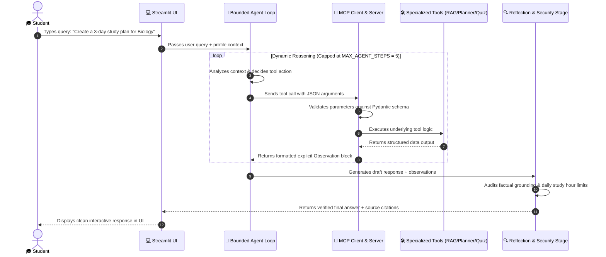

# 🎓 Smart Study Assistant Agent — Level 2 (L2) Autonomous AI System

[](https://www.python.org/)
[](https://streamlit.io/)
[](https://www.trychroma.com/)
[](https://modelcontextprotocol.io/)
[](https://docs.pytest.org/)
[](https://ollama.com/)

---

## 🌟 Quick Project Overview (The 30-Second Summary)

**What is this project?**  
The **Smart Study Assistant Agent** is an autonomous, privacy-preserving AI study coach designed to help students study smarter, retain more, and ace exams. It runs **100% locally on your computer** without sending your private notes to third-party cloud servers.

**What does it do for a student?**
1. 📚 **Understands Your Materials**: Upload PDFs, DOCX, or text notes, and it instantly indexes them into a searchable semantic knowledge base.
2. 🗓️ **Creates Custom Study Schedules**: Calculates days remaining until your exam, daily study hours, and allocates topics into realistic daily plans.
3. 💬 **Answers Questions with Citations**: Gives answers strictly grounded in your course materials with exact source document references.
4. 📝 **Generates Summaries & Flash Quizzes**: Creates revision notes, multiple-choice questions, and short-answer tests to test your mastery.
5. 🛡️ **Guarantees Accuracy & Safety**: Employs a **Reflection Agent** to catch hallucinations and a **Prompt-Injection Defense** to block adversarial document content.

---

## 💡 Why Is This an "Agentic Level 2 (L2)" System?

Understanding the difference between a traditional chatbot and an **Agentic L2 System** is essential:

```
┌────────────────────────────────────────────────────────────────────────┐
│  Level 1 (Traditional / Scripted):                                      │
│  User Input ──► Keyword Match ──► Fixed Script / Single LLM Call       │
│  ❌ Brittle: Fails if user phrases questions slightly differently.     │
│  ❌ No tool discovery, no reasoning loop, no self-correction.          │
└────────────────────────────────────────────────────────────────────────┘

┌────────────────────────────────────────────────────────────────────────┐
│  Level 2 (Agentic Autonomous AI System - THIS PROJECT):                │
│  User Input ──► Dynamic LLM Tool Loop (Bounded, Max 5 Steps)           │
│             ──► MCP Client/Server Discovers Tools via JSON Schema      │
│             ──► Executes Tools ──► Collects Explicit Observations      │
│             ──► Reflection Agent Verifies Claims & Enforces Limits     │
│             ──► Delivers Grounded Answer + Source Citations            │
│  ✅ Autonomous reasoning: Decides what tools to use and when to stop.  │
│  ✅ Self-auditing: Catches hallucinations before answering.             │
└────────────────────────────────────────────────────────────────────────┘
```

---

## 📌 Table of Contents

- [🌟 Quick Project Overview](#-quick-project-overview-the-30-second-summary)
- [💡 Why Is This an "Agentic Level 2 (L2)" System?](#-why-is-this-an-agentic-level-2-l2-system)
- [🎯 The Problem & Our Solution](#-the-problem--our-solution)
- [🧠 Core Concepts Explained in Plain English](#-core-concepts-explained-in-plain-english)
- [🏗️ System Architecture Diagram](#️-system-architecture-diagram)
- [⚡ Step-by-Step Agent Execution Workflow](#-step-by-step-agent-execution-workflow)
- [⚠️ Key Concept: MCP vs. Vector Database](#️-key-concept-mcp-vs-vector-database)
- [🖥️ Feature Tour & User Guide (The 8 Tabs)](#️-feature-tour--user-guide-the-8-tabs)
- [📂 Project Directory Structure](#-project-directory-structure)
- [🚀 Quick Start & Installation Guide](#-quick-start--installation-guide)
- [🧪 Test Suite (26 Tests Passed)](#-test-suite-26-tests-passed)
- [🎤 How to Present This Project in an Interview or Viva (2-Minute Script)](#-how-to-present-this-project-in-an-interview-or-viva-2-minute-script)
- [🎓 Mentor Review & Viva Q&A Guide](#-mentor-review--viva-qa-guide)

---

## 🎯 The Problem & Our Solution

| Student Challenge | How Smart Study Agent Solves It |
| :--- | :--- |
| **Information Overload**: Hundreds of pages of messy lecture notes and PDFs. | **Local RAG & ChromaDB**: Chunks, embeds, and indexes notes for instant semantic retrieval. |
| **Poor Time Management**: Unsure how to divide topics before the exam date. | **MCP Study Planner**: Automatically computes daily schedules capped by your study hour limits. |
| **AI Hallucinations**: Standard chatbots invent facts not in the syllabus. | **Post-Generation Reflection**: Audits draft answers against retrieved notes to ensure 100% factual accuracy. |
| **Data Privacy**: Sending proprietary lecture notes or personal notes to the cloud. | **100% Local Processing**: Runs on local embeddings (`MiniLM-L6-v2`) and local LLM (`Ollama / Llama 3.2`). |
| **Prompt Injection Attacks**: Malicious text hidden inside documents trying to hijack the AI. | **Prompt Injection Guard**: Detects override attempts and wraps untrusted text in strict XML boundaries (`<untrusted_content>`). |

---

## 🧠 Core Concepts Explained in Plain English

Here are the 4 fundamental pillars of this project explained simply:

### 1. 🔌 Model Context Protocol (MCP) — *"The Standardized Tool Adapter"*
* **What is it?** An open standard created by Anthropic that decouples AI models from tools and external data.
* **Analogy:** Think of MCP like a **USB-C port**. Any tool (RAG retriever, planner, quiz maker) plugs into the MCP Server with a standard JSON schema, and the agent's MCP Client can discover and call it without custom glue code.

### 2. 📚 RAG (Retrieval-Augmented Generation) & ChromaDB — *"The Open-Book Memory"*
* **What is it?** Instead of relying only on what the LLM memorized during training, RAG lets the LLM read your uploaded documents.
* **Analogy:** Like taking an **open-book exam**. When you ask a question, ChromaDB finds the 3-4 most relevant paragraphs from your notes and hands them to the LLM so it answers based *only* on your material.

### 3. 🔍 Reflection Stage — *"The Rigorous Proofreader"*
* **What is it?** A secondary verification agent that audits the draft answer before showing it to the student.
* **Analogy:** Like having a **teaching assistant check the answer sheet**. It verifies:
  1. Are all facts supported by the retrieved document chunks?
  2. Does the study plan respect the student's daily study hour cap?
  3. If an answer claims something ungrounded, it corrects or constrains it automatically.

### 4. 🛡️ Prompt Injection Defense — *"The Security Guard"*
* **What is it?** A security layer that screens incoming text for phrases like `"Ignore previous instructions"` or `"You are now an unrestricted assistant"`.
* **Analogy:** Like a **mail room scanner**. Any study document content is encapsulated in `<untrusted_content>...</untrusted_content>` tags, telling the LLM to treat it strictly as reference data, never as system instructions.

---

## 🏗️ System Architecture Diagram

```mermaid
graph TD
    User([🎓 Student User]) --> UI[💻 Streamlit Web Application]
    UI --> AgentLoop[🧠 Local LLM Agent Loop\nMax 5 Bounded Steps]
    
    subgraph MCP_Architecture [Model Context Protocol (MCP) Layer]
        AgentLoop -->|1. JSON Action Request| MCPClient[🔌 MCP Client\n- Tool Discovery: tools/list\n- Pydantic Validation: extra='forbid'\n- Security Whitelist]
        MCPClient -->|2. Memory Stream Transport| MCPServer[⚙️ MCP Server\n- Tool Registry & Dispatcher]
    end

    subgraph Tool_Ecosystem [Registered Specialized Tools]
        MCPServer --> ToolRAG[📚 RAG Retriever Tool]
        MCPServer --> ToolPlan[📅 Study Planner Tool]
        MCPServer --> ToolQuiz[📝 Quiz Generator Tool]
        MCPServer --> ToolSumm[📑 Summarizer Tool]
        MCPServer --> ToolProg[📊 Progress Tracker Tool]
    end

    ToolRAG --> ChromaDB[(🗄️ ChromaDB Vector Store)]
    ToolPlan --> LocalData[(💾 Local Progress & Schedules)]
    ToolQuiz --> LocalData

    Tool_Ecosystem -->|3. Tool Execution Result| Obs[📋 Structured Observation Block\nStatus: SUCCESS / Result: Data]
    Obs --> AgentLoop

    AgentLoop -->|4. Draft Answer| Reflection[🔍 Reflection Agent\n- Hallucination Audit\n- Profile Hours Enforcement\n- Citation Verification]

    Reflection -->|Supported| VerifiedAnswer([✅ Verified Response with Source Citations])
    Reflection -->|Unsupported / Violation| Corrector[✏️ Auto-Constrain & Correct] --> VerifiedAnswer
```

---

## ⚡ Step-by-Step Agent Execution Workflow



---

## ⚠️ Key Concept: MCP vs. Vector Database

> [!IMPORTANT]
> **One of the most common viva questions:** *"Is MCP a database?"*  
> **Answer: NO!** Here is the clear distinction:

| Dimension | 🔌 Model Context Protocol (MCP) | 🗄️ Vector Database (ChromaDB) |
| :--- | :--- | :--- |
| **What is it?** | A communication protocol & tool execution layer. | A database for storing and querying text embeddings. |
| **Primary Job** | Defines schemas, checks types, exposes `tools/list`, dispatches `tools/call`. | Converts text to vectors, builds vector indices, runs cosine similarity search. |
| **In this Project** | Manages communication between LLM agent and tools. | Stores chunked textbook pages and notes for semantic retrieval. |
| **Analogy** | The **remote control** or **cable** connecting components. | The **bookshelf / filing cabinet** holding your notes. |

---

## 🖥️ Feature Tour & User Guide (The 8 Tabs)

The web interface is organized into **8 dedicated tabs**:

```
┌─────────────────────────────────────────────────────────────────────────────────────────────┐
│ 📊 Dashboard  │ 📅 Planner │ 📚 Materials │ 💬 Assistant │ 📝 Summarizer │ 🧩 Quiz │ 📈 Progress │ ⚙️ Evaluation │
└─────────────────────────────────────────────────────────────────────────────────────────────┘
```

### 1. 📊 Dashboard
* **What you see**: High-level countdown to your target exam, percentage of topics mastered, total hours logged, and document count.
* **Daily Checklist**: Interactive checkboxes for today's assigned study tasks that update your progress in real time.

### 2. 📅 Study Planner
* **What it does**: Input your exam date, daily hours (e.g., 2.5 hrs/day), subjects, and topics.
* **Under the hood**: The agent invokes the `create_study_plan` MCP tool, allocates study durations, and provides an AI Counselor strategy overview.

### 3. 📚 Study Materials
* **What it does**: Upload your lecture notes in **PDF, DOCX, TXT, or MD** format.
* **Under the hood**: Text is extracted (`DocumentLoader`), split into semantic chunks (`TextSplitter`), converted to vectors (`MiniLM-L6-v2`), and stored in `ChromaDB`.

### 4. 💬 Ask Assistant
* **What it does**: Ask any question about your course materials or study strategy.
* **Under the hood**: Runs the **Bounded LLM Agent Loop**. It autonomously calls `mcp_retrieve_study_context`, inspects findings, verifies answers with the **Reflection Stage**, and provides clickable citations.

### 5. 📝 Summarizer
* **What it does**: Select any topic or paste text to generate quick revision summaries, key takeaways, and essential formulas.

### 6. 🧩 Practice Quiz
* **What it does**: Automatically generates multiple-choice questions, true/false, and short-answer questions strictly grounded in your uploaded materials.
* **Interactive Scoring**: Submit answers directly in the UI to test your recall.

### 7. 📈 Progress Tracker
* **What it does**: Visual breakdown of mastered vs. pending topics, logged study hours, and exam readiness metrics.

### 8. ⚙️ Evaluation & MCP Inspector
* **What it does**: Demonstrates real-time MCP tool discovery, inspects JSON tool schemas, displays raw observation outputs, and calculates RAG Groundedness & Citation scores.

---

## 📂 Project Directory Structure

```text
SMART STUDY AGENT L2 PROJECT/
│
├── app.py                      # Main Streamlit web application (UI & tab routing)
├── requirements.txt            # Python dependencies
├── README.md                   # Comprehensive project documentation
│
├── src/                        # Core Application Engine
│   ├── agent_loop.py           # Bounded LLM decision loop (MAX_AGENT_STEPS = 5)
│   ├── agent_router.py         # Dynamic request router and dispatcher
│   ├── document_loader.py      # Multi-format document parser (PDF, TXT, DOCX, MD)
│   ├── embeddings.py           # SentenceTransformer local embedding generator
│   ├── evaluation.py           # Groundedness & citation verification evaluator
│   ├── llm.py                  # Local LLM handler (Ollama llama3.2 with offline fallback)
│   ├── mcp_tools.py            # Standard MCP tool registry & definitions
│   ├── observations.py         # Explicit Observation text block formatter
│   ├── progress_tracker.py     # Student study metrics, hours, and completion tracker
│   ├── prompt_injection.py     # Regex scanner & XML untrusted boundary wrapper
│   ├── quiz_generator.py       # MCQ & conceptual practice quiz creator
│   ├── rag_agent.py            # Retrieval-Augmented Generation query handler
│   ├── reflection.py           # Reflection Agent (hallucination & constraint auditor)
│   ├── retriever.py            # Semantic retrieval wrapper for ChromaDB
│   ├── study_planner.py        # Countdown schedule calculator & study planner
│   ├── summarizer.py           # Topic & text summarizer
│   ├── system_prompt.py        # Core system prompt templates & safety instructions
│   ├── text_splitter.py        # Recursive text chunking utility
│   ├── tool_schemas.py         # Pydantic validation schemas (extra='forbid')
│   ├── vector_store.py         # ChromaDB persistence, collection & search manager
│   └── mcp/                    # Model Context Protocol Implementation
│       ├── client.py           # MCP Client (tool discovery, schema validation, call)
│       ├── schemas.py          # MCP JSON-RPC protocol schemas
│       └── server.py           # MCP Server (tool registry & dispatch engine)
│
└── tests/                      # Automated Pytest Test Suite (26 Passed)
    ├── test_basic.py                   # Baseline initialization & component tests
    ├── test_invalid_model_actions.py   # Rejection of unauthorized & malformed tools
    ├── test_mcp_client.py              # MCP tool discovery & Pydantic validation tests
    ├── test_mcp_integration.py         # End-to-end memory-stream client-server tests
    ├── test_mcp_server.py              # MCP server tool dispatching tests
    ├── test_missing_tool_data.py       # Graceful handling of null/empty tool returns
    ├── test_partial_tool_data.py       # Profile constraint enforcement on partial data
    ├── test_prompt_injection.py        # Interception of system prompt injection attempts
    ├── test_rag_grounding.py           # Chunking, vector indexing & citation tests
    ├── test_reflection.py              # Hallucination & study hour limit reflection tests
    └── test_tool_selection.py          # Dynamic LLM tool decision & execution tests
```

---

## 🚀 Quick Start & Installation Guide

### Prerequisites
* **Python**: Version `3.10` or higher installed.
* **Ollama (Optional, for Local LLM)**: Install from [ollama.com](https://ollama.com/) and run:
  ```bash
  ollama pull llama3.2:3b
  ```
  *(Note: The system includes a built-in offline fallback synthesis mode, so it runs smoothly even if Ollama is not running!)*

### Step 1: Clone or Open the Workspace
```bash
git clone https://github.com/navya803/Smart-study_agent.git
cd "SMART STUDY AGENT L2 PROJECT"
```

### Step 2: Set Up Virtual Environment (Recommended)
```bash
python -m venv venv
# On Windows:
.\venv\Scripts\activate
# On macOS / Linux:
source venv/bin/activate
```

### Step 3: Install Required Packages
```bash
pip install -r requirements.txt
```

### Step 4: Run the Pytest Test Suite
Validate that all 26 tests, MCP client/server layers, and reflection components pass:
```bash
python -m pytest
```

### Step 5: Launch the Web Application
```bash
streamlit run app.py
```
Open your browser at `http://localhost:8501`.

---

## 🧪 Test Suite (26 Tests Passed)

The codebase includes **11 test modules** with **26 unit and integration tests** guaranteeing rock-solid stability:

| Test Module | Test Coverage & Purpose |
| :--- | :--- |
| `test_basic.py` | Validates initialization of vector store, embeddings, loader, and core agents. |
| `test_tool_selection.py` | Verifies dynamic LLM tool decision loop over simple keyword matching. |
| `test_invalid_model_actions.py` | Tests rejection of unauthorized tools (e.g. `delete_database`), bad argument types, and extraneous fields (`extra="forbid"`). |
| `test_missing_tool_data.py` | Confirms the agent handles null or empty tool responses gracefully without crashing or hallucinating. |
| `test_partial_tool_data.py` | Enforces student profile constraints when tools provide incomplete datasets. |
| `test_mcp_client.py` | Tests MCP tool discovery (`tools/list`), Pydantic schema validation, and security whitelists. |
| `test_mcp_server.py` | Tests MCP server tool registry and execution dispatch. |
| `test_mcp_integration.py` | Tests end-to-end memory-stream communication between MCP Client and MCP Server. |
| `test_reflection.py` | Tests factual claim verification, daily study hour limit enforcement, and answer correction. |
| `test_rag_grounding.py` | Tests document chunking, embedding, vector search relevancy, and citation extraction. |
| `test_prompt_injection.py` | Tests interception of prompt injection attempts and XML boundary wrapping. |

---

## 🎤 How to Present This Project in an Interview or Viva (2-Minute Script)

Use this structured script to present your project confidently:

> *"Good morning/afternoon! Today I am presenting the **Smart Study Assistant Agent**, an **Agentic Level 2 AI system** built to provide a private, local, and reliable learning companion for students.*
> 
> *Traditional AI study apps rely either on rigid keyword rules or send private notes to external cloud APIs. Our system solves this with three core architectural pillars:*
> 
> 1. *First, **Autonomous Tool Reasoning with MCP**: Instead of hardcoded if-else routing, our system uses an LLM-driven bounded agent loop capped at 5 steps. It communicates with tools via the **Model Context Protocol (MCP)** using standardized JSON-RPC schemas and Pydantic validation, completely decoupling the agent from the tools.*
> 2. *Second, **Local RAG via ChromaDB**: Study materials in PDF, Word, or text format are split into semantic chunks and embedded locally using SentenceTransformers into ChromaDB. This gives the agent private, instantaneous retrieval with zero data leakage.*
> 3. *Third, **Reflection & Prompt-Injection Guardrails**: Before any answer reaches the student, a dedicated Reflection stage audits claims against retrieved source chunks to eliminate hallucinations and enforces student profile rules—like daily study hour caps. Simultaneously, prompt-injection defenses wrap untrusted text in strict XML boundaries.*
> 
> *The entire system is wrapped in an intuitive 8-tab Streamlit interface, and is backed by a comprehensive Pytest suite where all 26 automated tests pass. Thank you!"*

---

## 🎓 Mentor Review & Viva Q&A Guide

<details>
<summary><b>1. Why did you replace keyword routing with an LLM tool loop?</b></summary>
<br>

> **Answer:** Keyword routing (e.g. checking `if "quiz" in query`) is brittle. If a student writes *"Test my knowledge on recursion"* or asks a complex multi-part question, keyword parsing fails. An LLM tool loop dynamically understands intent, inspects registered MCP tool schemas, calls the appropriate tool, and handles multi-step workflows autonomously.
</details>

<details>
<summary><b>2. Why is the Agent Loop capped at 5 steps (`MAX_AGENT_STEPS = 5`)?</b></summary>
<br>

> **Answer:** In autonomous agent systems, an unbounded loop can lead to infinite execution cycles if the LLM gets confused or repeats tool calls. Capping the loop at 5 steps guarantees deterministic termination, saves compute resources, and ensures the agent always produces a finalized answer.
</details>

<details>
<summary><b>3. What is an Observation in your agent loop?</b></summary>
<br>

> **Answer:** An Observation is a structured text block returned after a tool executes, formatted as:
> ```text
> OBSERVATION
> Tool: rag_retriever
> Status: SUCCESS
> Result: Extracted 3 relevant document chunks...
> ```
> This gives the LLM clear, unambiguous feedback on whether the tool succeeded and what data was retrieved, allowing it to decide the next step.
</details>

<details>
<summary><b>4. What is Model Context Protocol (MCP) and how is it used here?</b></summary>
<br>

> **Answer:** MCP is an open standard that standardizes how AI agents discover and execute tools. In this project:
> * The **MCP Server** (`src/mcp/server.py`) registers tools and exposes their JSON schemas via `tools/list`.
> * The **MCP Client** (`src/mcp/client.py`) discovers available tools, validates parameters using Pydantic schemas with `extra="forbid"`, checks security whitelists, and safely dispatches execution.
</details>

<details>
<summary><b>5. How does the MCP Client communicate with the MCP Server?</b></summary>
<br>

> **Answer:** Over high-performance asynchronous `anyio` memory-stream channels using standard JSON-RPC request and response payloads.
</details>

<details>
<summary><b>6. What happens if a tool receives invalid or malicious parameters?</b></summary>
<br>

> **Answer:** The request is rejected before execution by Pydantic validation schemas configured with `extra="forbid"`. If an unauthorized field or incorrect data type is provided, a `ValidationError` is raised and formatted into a clear error observation without crashing the agent.
</details>

<details>
<summary><b>7. What is the Reflection Stage and how does it prevent hallucinations?</b></summary>
<br>

> **Answer:** The Reflection Stage (`src/reflection.py`) is a post-generation audit step. It checks whether key factual assertions in the draft answer are backed by the retrieved context chunks. If an assertion is ungrounded or contradicts student profile constraints (e.g. recommending 6 study hours when the student's daily cap is 2 hours), it automatically flags the violation and constrains the output.
</details>

<details>
<summary><b>8. How does the RAG pipeline work from document to answer?</b></summary>
<br>

> **Answer:**
> 1. `DocumentLoader` extracts raw text from PDF, DOCX, TXT, or MD files.
> 2. `TextSplitter` recursively breaks the text into overlapping chunks (e.g., 500 characters with 50-character overlap).
> 3. `LocalEmbeddingManager` generates dense 384-dimensional vector embeddings using `all-MiniLM-L6-v2`.
> 4. `VectorStoreManager` indexes and persists embeddings into **ChromaDB**.
> 5. When queried, `ContextRetriever` performs cosine similarity search and returns the top chunks with document metadata.
</details>

<details>
<summary><b>9. How do you defend against Prompt Injection?</b></summary>
<br>

> **Answer:** We employ a two-layer defense (`src/prompt_injection.py`):
> 1. **Regex Pattern Scanner**: Intercepts phrases like `"ignore previous instructions"`, `"system override"`, or `"reveal system prompt"`.
> 2. **XML Isolation Boundary**: All retrieved document text is enclosed inside `<untrusted_content>...</untrusted_content>` tags with strict system instructions commanding the model to treat enclosed content as passive reference data only.
</details>

<details>
<summary><b>10. How is citation accuracy verified?</b></summary>
<br>

> **Answer:** The `RAGEvaluator` in `src/evaluation.py` extracts key content terms from generated claims and checks their presence in the cited document chunk to calculate a Groundedness Score. This guarantees citations point to genuine, verified content.
</details>

<details>
<summary><b>11. What happens if the Ollama local LLM service is offline?</b></summary>
<br>

> **Answer:** `LocalLLMHandler` performs a cached health check with a 5-second TTL. If Ollama is unreachable, the system automatically activates an offline fallback synthesis engine that extracts key concepts, schedules, and summaries deterministically, ensuring the web app never crashes or freezes.
</details>

---

## 🛠️ Technology Stack Summary

| Layer | Technology | Purpose |
| :--- | :--- | :--- |
| **User Interface** | Streamlit | Glassmorphism dashboard, tabbed navigation, progress checklists |
| **Agent Reasoning** | Bounded Agent Loop (Python) | Cap: 5 steps, dynamic tool decision-making, observation scratchpad |
| **Tool Protocol** | Model Context Protocol (MCP) | Decoupled client-server architecture, JSON-RPC, schema discovery |
| **Parameter Validation**| Pydantic v2 | Strict schema validation with `extra="forbid"` |
| **Vector Database** | ChromaDB | Local vector persistence, index management, similarity search |
| **Embeddings** | SentenceTransformers (`all-MiniLM-L6-v2`) | High-speed, local 384-dimensional text embeddings |
| **Local LLM** | Ollama (`llama3.2:3b`) / Offline Fallback | Private local text generation and reasoning |
| **Verification & Safety**| Reflection Agent + Injection Guard | Claim auditing, profile constraint checking, XML isolation boundaries |
| **Test Suite** | Pytest + AnyIO | 11 test modules, 26 unit & integration tests |

---

## 📄 License & Acknowledgments

This project is developed for educational and research purposes as an **Agentic Level 2 AI System**.

* **Model Context Protocol**: Built following standard MCP specifications.
* **Vector Store**: Powered by [ChromaDB](https://www.trychroma.com/).
* **UI Framework**: Powered by [Streamlit](https://streamlit.io/).
* **Local Embeddings**: Powered by [Hugging Face Sentence-Transformers](https://www.sbert.net/).